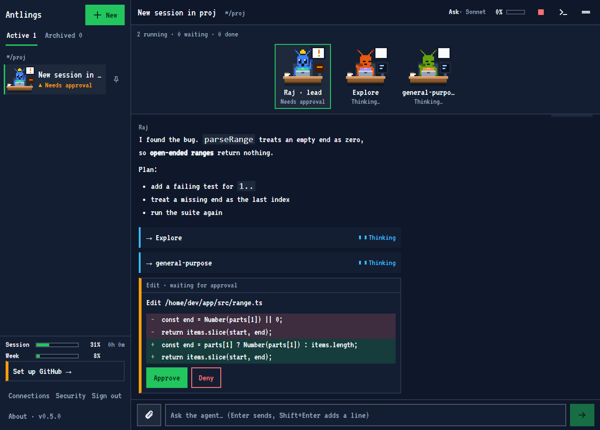

<h1 align="center">Antlings</h1>

<p align="center"><b>Your Claude Code colony, in a browser.</b></p>

<p align="center">
  <a href="https://github.com/arifintahu/antlings/actions/workflows/ci.yml"></a>
  <a href="https://github.com/arifintahu/antlings/releases"></a>
  <a href="https://nodejs.org"></a>
  <a href="LICENSE"></a>
</p>

Antlings is a self-hosted web UI for [Claude Code](https://code.claude.com) on your own Linux server. Start a task from your laptop, close the lid, and check on it from your phone. Every session has a **lead ant** with a crown. Every subagent it starts becomes a **worker ant** at its own desk, so you can see at a glance who is thinking, running a tool, waiting for your approval, or done.




## Why ants

In a terminal, Claude Code with subagents is a scroll of text. You cannot tell which helper is stuck, which one waits for a yes from you, and which one has finished. Ants do the same thing at a small scale: many workers, each with one job, coordinated by one that knows the plan.

An ant's desk shows its state: **idle**, **thinking**, **running a tool**, **needs approval**, **done** or **error**. The state is also written as text under the ant. The ants are drawn in code on a 32x28 canvas, and they stop moving when your system asks for reduced motion.

## Features

- **Sessions:** start, resume, rename, pin, archive and delete. Pick the folder, model, effort and permission mode for each one.
- **Approvals you can read:** a waiting tool call shows the command, the file content or a diff before you press Approve or Deny.
- **Subagents:** one ant per subagent with its state, current tool, tokens, log and final report. Stop one, or send a follow-up through the lead.
- **Meters:** context window use and cost per session, and plan usage limits when your login supports them.
- **Phone friendly:** installable as a PWA, usable one-handed, with push notifications when an approval is waiting.
- **Access control:** passkey sign-in (or password plus authenticator code), a fresh check before risky actions, and a 15 minute lockout after failed sign-ins. See [ADR 0002](docs/adr/0002-authentication-and-trust-boundary.md).
- **Small and accessible:** about 100 MB idle, plus roughly 200 MB per running session. The layout works at 375 px, and the browser tests run axe in light and dark.

## Try it locally

No Claude login needed. This runs the whole app against a fake agent:

```bash
git clone https://github.com/arifintahu/antlings.git
cd antlings
pnpm install && pnpm build
pnpm --filter @antlings/server exec tsx src/e2e/server.ts   # http://localhost:3199
```

Requires Node 24+ and [pnpm](https://pnpm.io) 9. Setup code, hot reload and running against real Claude Code are in [docs/DEVELOPMENT.md](docs/DEVELOPMENT.md).

## Deploy to your own server

Antlings is for one owner on a small VPS (about 2 GB of memory and 2 vCPUs).

**You need:**

- A Linux server with systemd (tested on Ubuntu 24.04), Node 24+, a user with `sudo`, and [Claude Code](https://code.claude.com/docs/en/setup) installed system-wide.
- [Caddy](https://caddyserver.com) and a domain whose DNS A record points at the server. Passkeys need HTTPS.
- Docker, Git and key-based SSH on your own machine. The release is built in a container, so the server needs no compiler.

**1.** Add this line once to `/etc/caddy/Caddyfile` on the server:

```
import /etc/caddy/antlings.caddy
```

**2.** Deploy from your machine:

```bash
VPS_SSH=you@your-server DOMAIN=ants.example.com ./deploy/deploy.sh
```

This builds a release, copies it over and runs `deploy/install.sh`. The installer creates an unprivileged `antlings` user, installs a hardened systemd service on `127.0.0.1:3100`, generates secrets, writes the Caddy site and checks `/health`. If the new release does not answer, it rolls back. It never touches your firewall, databases or other sites. Preview it with `sudo ./deploy/install.sh --dry-run`.

**3.** Print the one-time setup code on the server:

```bash
sudo -u antlings antlings setup
```

**4.** Open `https://ants.example.com`, enter the code (valid for 15 minutes) and create your passkey.

**5.** Open **Connections** in the sidebar to connect Claude and GitHub. Each change asks for a fresh passkey check.

No domain yet? Leave out `DOMAIN` and use an SSH tunnel: `ssh -L 3100:127.0.0.1:3100 you@your-server`, then open `http://localhost:3100`.

### Connecting Claude

- **API key (default):** paste an Anthropic API key on the Connections page. Antlings checks it, then stores it encrypted. Anthropic's terms ask products built on the Agent SDK to use API keys.
- **Subscription (personal use only):** relays the sign-in of the unmodified `claude` binary. Read [ADR 0003](docs/adr/0003-claude-login-terms.md) first. You take that terms risk yourself.

Settings live in `/etc/antlings/antlings.env`. The full list is in [.env.example](.env.example). Backups, updates, rollback, key rotation and uninstalling are in the [runbook](docs/RUNBOOK.md).

## Security: read this before you expose it

Antlings lets a browser run an AI agent that can read and write files and run commands on your server. Treat it like SSH access.

- **The agent runs as the same Unix user as the service.** A prompt-injected agent can read the service's settings and database. Approvals protect against a stolen browser session, not against the agent itself. Use a dedicated API key with a spend cap, keep Bypass mode rare, and do not point it at folders that hold secrets.
- **The agent can reach everything listening on `127.0.0.1`** on that server. Add a firewall rule for the `antlings` user, see [the runbook](docs/RUNBOOK.md#known-limits).

The full threat model is in [ADR 0002](docs/adr/0002-authentication-and-trust-boundary.md). To report a vulnerability, see [SECURITY.md](SECURITY.md).

## Docs and contributing

[Development](docs/DEVELOPMENT.md) · [Architecture](docs/ARCHITECTURE.md) · [Runbook](docs/RUNBOOK.md) · [SDK notes](docs/sdk-notes.md) · [Decision records](docs/adr/) · [Contributing](CONTRIBUTING.md)

## License

[MIT](LICENSE). Antlings is an independent project and is not affiliated with or endorsed by Anthropic. "Claude" and "Claude Code" are trademarks of Anthropic.
