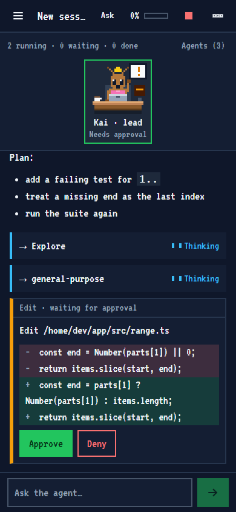
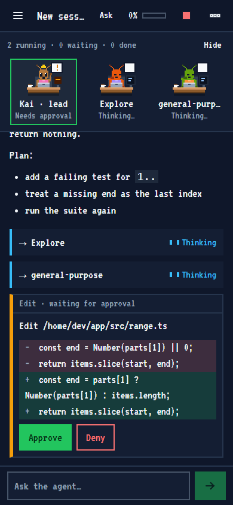
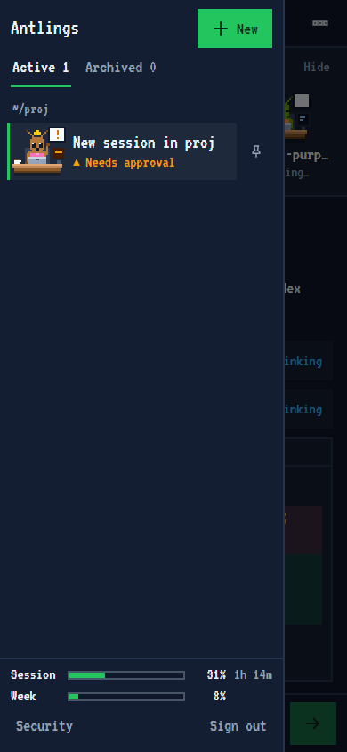
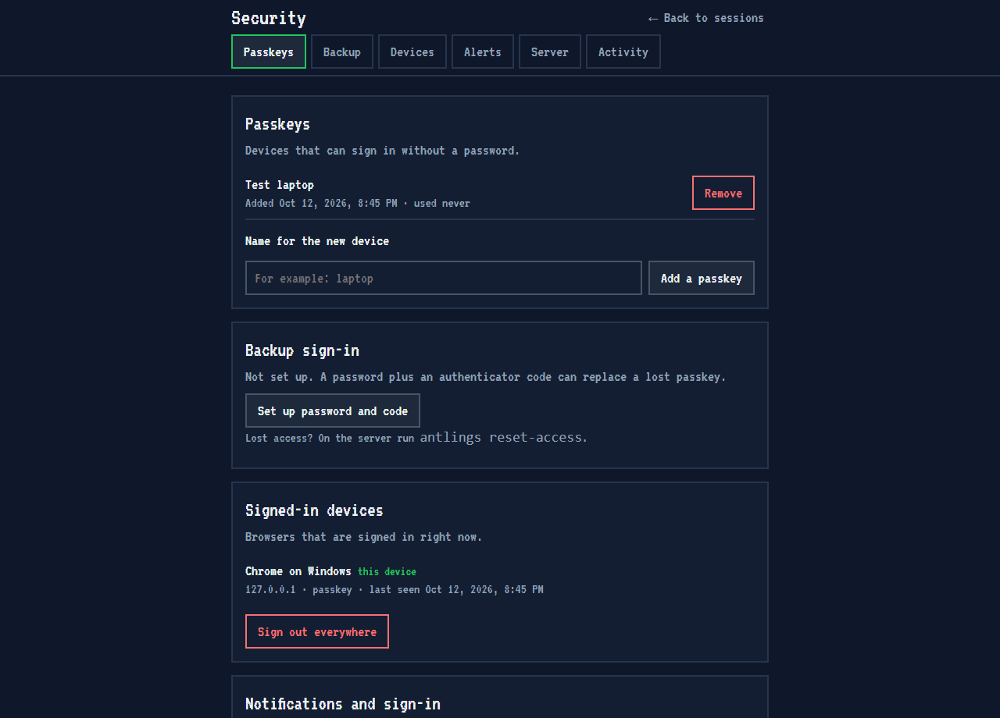

# Antlings

A self-hosted web UI for [Claude Code](https://code.claude.com). Run it on your own Linux server, open it from a laptop or a phone, and drive Claude Code sessions from the browser.

Every session has a **lead ant**. Every subagent the lead starts becomes a **worker ant** at its own desk, so you can see who is thinking, running a tool, waiting for you, or done.


<p>
  
  
  
</p>

The Security page: passkeys, signed-in devices, notifications, server status and recent activity.



## Features

- **Sessions:** start, resume, rename, pin, archive and delete Claude Code sessions. Pick the folder, model, effort and permission mode for each one. Sessions are grouped by project and searchable.
- **Approvals you can read:** a waiting tool call shows the command, the file content, or a diff before you press Approve or Deny.
- **Streaming and markdown:** answers stream in as they are written and render as safe markdown. Links and code blocks never run anything.
- **Subagents:** one ant per subagent with its state, current tool, tokens, log and final report. Stop one, or send a follow-up through the lead.
- **Meters:** context window use per session, cost per session, and plan usage limits when your login supports them.
- **Phone friendly:** installable as a PWA, usable one-handed, with push notifications when an approval is waiting.
- **Access control:** passkey sign-in, or password plus authenticator code. A fresh check is asked before risky actions such as Bypass mode or deleting a session. Failed sign-ins lock out for 15 minutes. See [ADR 0002](docs/adr/0002-authentication-and-trust-boundary.md).
- **Small:** about 100 MB of memory when idle. Each running Claude Code session adds roughly 200 MB.
- **Accessible:** every state has a text label next to its animation, the layout works at 375 px, `prefers-reduced-motion` is respected, and the browser tests run axe in light and dark themes.

## How it works

```
Phone or laptop (PWA) ──HTTPS──> Caddy ──127.0.0.1──> Antlings (Node)
                                                        │ one streaming query() per session
                                                        ▼
                                          Claude Agent SDK → Claude Code
```

The backend keeps one Claude Code process per running session, logs every event with a sequence number, and replays what a page missed when it reconnects. Transcripts stay in Claude Code's own `~/.claude` folder. More in [docs/ARCHITECTURE.md](docs/ARCHITECTURE.md).

## Try it locally

You need Node 22 or newer and [pnpm](https://pnpm.io) 9. This runs the whole app against a **fake agent**, so you do not need a Claude login and nothing is spent:

```bash
git clone https://github.com/arifintahu/antlings.git
cd antlings
pnpm install
pnpm --filter @antlings/server exec tsx src/e2e/server.ts   # http://localhost:3199
```

To run it against real Claude Code on your own machine, set `ANTHROPIC_API_KEY` (see [Claude login](#claude-login)):

```bash
cp .env.example .env     # fill in ANTLINGS_SECRET_KEY, see the comment in the file
pnpm build
pnpm --filter @antlings/server dev                          # http://localhost:3100
pnpm --filter @antlings/server exec tsx src/cli.ts setup    # prints a one-time setup code
```

Open the page, enter the setup code, and register your passkey.

## Deploy to your own server

Antlings is meant for one owner on a small VPS. Plan for about 2 GB of memory and 2 vCPUs. The installer refuses to run with less than 600 MB free.

**You need:**

- A Linux server with systemd (tested on Ubuntu 24.04), Node 22 or newer, and a user with `sudo`.
- [Claude Code](https://code.claude.com/docs/en/setup) installed system-wide on the server, for example at `/usr/local/bin/claude`.
- [Caddy](https://caddyserver.com) on the server, with a domain whose DNS A record points at it. Caddy gets the HTTPS certificate. Passkeys need HTTPS (or `localhost`).
- Docker, Git and key-based SSH to the server on your own machine. The release is built in a container so the server needs no compiler.

**1. Let Caddy load the Antlings file.** Add this line once to `/etc/caddy/Caddyfile` on the server, or use a `conf.d` folder that is already imported:

```
import /etc/caddy/antlings.caddy
```

**2. Deploy.** On your machine:

```bash
VPS_SSH=you@your-server DOMAIN=ants.example.com ./deploy/deploy.sh
```

This builds a release, copies it over, and runs `deploy/install.sh` on the server. The installer checks the file checksum, creates an unprivileged `antlings` user, installs a hardened systemd service bound to `127.0.0.1:3100`, writes `/etc/antlings/antlings.env` with generated secrets, writes the Caddy site, reloads Caddy, and checks `/health`. If the new release does not answer, it rolls back to the previous one. It never touches your firewall, databases or other sites. Read what it will do first with `sudo ./deploy/install.sh --dry-run` (see the [runbook](docs/RUNBOOK.md)).

**3. Give it a Claude login** (see below), then **print the setup code** on the server:

```bash
sudo -u antlings antlings setup
```

**4. Open `https://ants.example.com`**, enter the code (valid for 15 minutes) and create your passkey. Optionally add a backup password and authenticator code on the Security page.

Do not have a domain yet? Leave out `DOMAIN` to keep the service on `127.0.0.1` and reach it through an SSH tunnel: `ssh -L 3100:127.0.0.1:3100 you@your-server`, then open `http://localhost:3100`.

### Claude login

Antlings never handles Claude credentials. It starts the real `claude` binary through the Agent SDK. Anthropic's terms ask products built on the Agent SDK to use API keys, so **API key mode is the default**: put `ANTHROPIC_API_KEY=...` in `/etc/antlings/antlings.env` (use a dedicated key with a spend cap) and run `sudo systemctl restart antlings`.

For personal use you can instead sign in as the service user with `sudo -u antlings -H claude login` and set `ANTLINGS_AUTH_MODE=subscription` and `ANTLINGS_SUBSCRIPTION_OK=1`. Read [ADR 0003](docs/adr/0003-claude-login-terms.md) first. You take that terms risk yourself.

### Configuration

Settings live in `/etc/antlings/antlings.env` (restart the service after a change). The common ones:

| Setting | Meaning | Default |
|---|---|---|
| `ANTLINGS_ORIGIN` | The exact public address, for example `https://ants.example.com`. Used for the Origin check and cookies. | set by the installer |
| `ANTLINGS_AUTH_MODE` | `apikey` or `subscription` | `apikey` |
| `ANTLINGS_MAX_SESSIONS` | Claude Code processes running at once | 2 |
| `ANTLINGS_MAX_SUBAGENTS` | Concurrent subagents per session | 3 |
| `ANTLINGS_IDLE_HOURS` | Sign-in idle timeout | 12 |
| `ANTLINGS_HOME` | Root of the folder picker | `/home/antlings` |
| `ANTLINGS_EVENT_KEEP` | Newest events kept per session | 20000 |

The full list is in [.env.example](.env.example). Backups, updates, rollback, key rotation, fail2ban and uninstalling are in the [runbook](docs/RUNBOOK.md).

## Security: read this before you expose it

Antlings lets a browser run an AI agent that can read and write files and run commands on your server. Treat it like SSH access.

- **The agent runs as the same Unix user as the service.** A prompt-injected agent can read the service's settings and database, and can run `antlings reset-access`. Approvals protect against a stolen browser session, not against the agent itself. Use a dedicated API key with a spend cap, keep Bypass mode rare, and do not point it at folders that hold secrets.
- **The agent can reach everything listening on `127.0.0.1`** on that server (databases, other services). Add a firewall rule for the `antlings` user, see [the runbook](docs/RUNBOOK.md#known-limits).
- Keep the server patched, use a long passkey-protected sign-in, and put your own address in the fail2ban `ignoreip` list.

The full threat model is in [ADR 0002](docs/adr/0002-authentication-and-trust-boundary.md). To report a vulnerability, see [SECURITY.md](SECURITY.md).

## Development

```bash
pnpm install
pnpm lint            # eslint and prettier
pnpm test            # server, shared and web unit tests, plus svelte-check
pnpm build
pnpm e2e             # Playwright against the fake agent, uses the installed Chrome
```

The opt-in live test calls the real SDK with Haiku and is capped at 0.10 USD: `ANTLINGS_LIVE=1 pnpm --filter @antlings/server test`.

| Path | Contents |
|---|---|
| `server/` | Fastify backend: auth, sessions, WebSocket protocol, folder picker, push |
| `web/` | Svelte 5 app, ant sprites (`src/ants/draw.ts`), PWA files, Playwright tests (`e2e/`) |
| `shared/` | Protocol types and request schemas used by both |
| `deploy/` | systemd unit, Caddy snippet, fail2ban files, installer, release build, smoke tests |
| `design/` | The HTML mockup that the ant sprites were drawn in |
| `docs/` | [Architecture](docs/ARCHITECTURE.md), [runbook](docs/RUNBOOK.md), [SDK notes](docs/sdk-notes.md), [decision records](docs/adr/) |

The screenshots above are made by `pnpm --filter @antlings/web e2e showcase`. Contributions are welcome, see [CONTRIBUTING.md](CONTRIBUTING.md).

## License

[MIT](LICENSE). Antlings is an independent project and is not affiliated with or endorsed by Anthropic. "Claude" and "Claude Code" are trademarks of Anthropic.
